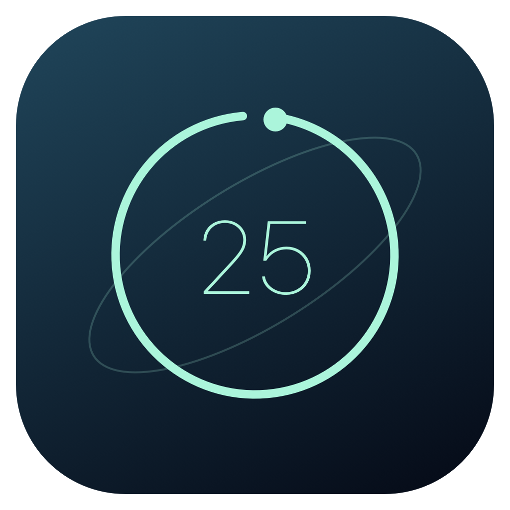
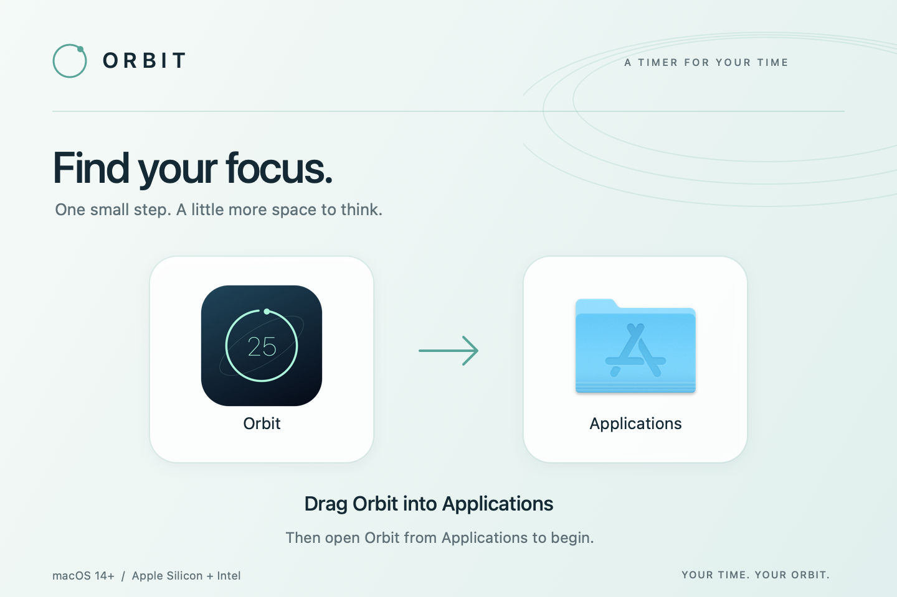

# Orbit

A native macOS Pomodoro timer with living gradient themes and a compact floating mode. Built with Swift, SwiftUI, and AppKit. No accounts, analytics, or network access.



**[Download the latest release](https://github.com/theedward/orbit-pomodoro/releases/latest)** · [MIT license](LICENSE)

## Requirements

- macOS 14 Sonoma or later.
- Apple Silicon or Intel Mac. The same universal download supports both.
- No Xcode, terminal commands, or additional software needed to install the app.

## Install

1. Open the [latest release](https://github.com/theedward/orbit-pomodoro/releases/latest).
2. Under **Assets**, download **`Orbit-1.2.1-universal.dmg`**. GitHub's “Source code” archives are for developers; they do not contain a ready-to-run app.
3. Double-click the DMG in Downloads.
4. In the Orbit installer window, **drag Orbit onto Applications**.
5. Open **Applications → Orbit**. You can now eject the Orbit disk image and delete the downloaded DMG.



### First launch and macOS security

This independent build is **ad-hoc signed, but not signed with an Apple Developer ID or notarized by Apple**. macOS may block the downloaded app on first launch.

If that happens, confirm that you downloaded it from this repository's Releases page, then open **System Settings → Privacy & Security**, find the message about Orbit, choose **Open Anyway**, and confirm **Open** when prompted. The option appears after a blocked launch attempt. If your Mac is managed by an organization, its policies may prevent this approval.

You can also inspect the source and [build locally](#build-from-source).

### ZIP alternative

Download `Orbit-1.2.1-universal.zip` from the same release, double-click it to extract **Orbit.app**, then drag the app into Applications. The same first-launch guidance applies.

### Upgrade

1. Quit Orbit using its menu bar menu → **Quit Orbit**, or ⌘Q. Closing its window alone does not quit the app.
2. Download the new DMG and drag Orbit into Applications.
3. Choose **Replace** when Finder asks, then reopen Orbit from Applications.

Your saved theme, session lengths, completed-session count, and timer state remain in macOS preferences. An active timer retains its original deadline.

### Verify the download (optional)

Each release includes `SHA256SUMS.txt`. In Terminal, run `shasum -a 256` followed by a space and drag the downloaded DMG into the Terminal window. Press Return and compare the result with the matching filename in `SHA256SUMS.txt`.

## Use Orbit

Choose **Focus**, **Short break**, or **Long break**, then press **Start session**. Defaults are 25 / 5 / 15 minutes; edit them in Settings. After four completed focus sessions, Orbit prepares a long break. Each session waits for you to start it.

- **Themes:** use the lower-left theme menu or Settings.
- **Mini mode:** click the compact-mode button in the header or press ⇧⌘M. The floating timer shares your current session, stays above other windows, and remembers its position. Expand it or close it to restore the full window.
- **Menu bar:** open the timer, switch to mini mode, start/pause, reset, or quit. The remaining time appears while running.
- **Settings:** adjust session lengths, completion sound, keep-on-top, and living effects. A ten-second demo shows the completion flow.
- **Completion:** a sound and an in-app message indicate the end of a session. Orbit prepares the next mode without starting it automatically.

| Shortcut | Action |
| --- | --- |
| Space | Start / pause |
| ⌘R | Reset the current timer |
| ⇧⌘M | Switch between full and mini mode |
| ⌘, | Open Settings from the full window |
| ⌘Q | Quit Orbit |

## Living themes

- **Stellar:** mint light, an orbital dial, drifting stars, and a moving satellite. Breaks turn the scene lavender.
- **Synthwave:** a striped sunset sinks as the session progresses, with animated equalizer bars and a moving horizon grid. Breaks become a cool dawn in Slow Club.
- **Cyberpunk:** an angular instrument panel, moving scan band, and pulsing segments that power down with session progress. Breaks enter a subdued Recovery Mode.

All themes use gradient backgrounds and controls. Continuous motion pauses with the timer, stops in the hidden full window during mini mode, respects macOS Reduce Motion, and can be disabled in Settings.

## Local data

Orbit stores its theme, session lengths, sound/effects preferences, completed-session count, and timer state in UserDefaults on your Mac. The countdown uses elapsed time, including time spent asleep or with the app closed. The app makes no network calls and has no external runtime dependencies.

## Build from source

Install Xcode or Apple's Command Line Tools, then:

```sh
git clone https://github.com/theedward/orbit-pomodoro.git
cd orbit-pomodoro
zsh test.sh
zsh build.sh
open Orbit.app
```

`build.sh` compiles both Apple Silicon and Intel binaries, combines them into a universal app, embeds the icon and license, and applies an ad-hoc signature. No Swift packages are needed.

### Build the installer

```sh
zsh package.sh
```

Outputs appear in `dist/`: the branded DMG, universal app ZIP, and SHA-256 checksums. On first run, packaging creates an isolated Python environment and installs the pinned tools in `Packaging/requirements.txt`. These tools are not bundled in the app.

The installer uses a Retina background, fixed icon positions, an Applications shortcut, and a custom volume icon. The script mounts the finished DMG read-only and verifies its app signature, architectures, icon, license, background metadata, and icon positions.

For Apple-notarized distribution, sign with your own Developer ID and notarize through Apple before sharing.

## Project layout

- `Sources/TimerEngine.swift`: timer state machine.
- `Sources/Orbit.swift`: application state, main window, Settings, and menu bar.
- `Sources/ThemeDials.swift`: distinct theme layouts and progress effects.
- `Sources/LivingThemes.swift`: break palettes and floating mini timer.
- `Tests/main.swift`: elapsed time, pause/resume, completion, break cycles, reset, custom durations, and wake-after-deadline checks.
- `Packaging/`: installer artwork generator, Finder layout, pinned build tools, and mounted-image verification.

## License

[MIT](LICENSE) © 2026 João Eduardo Seixas.
